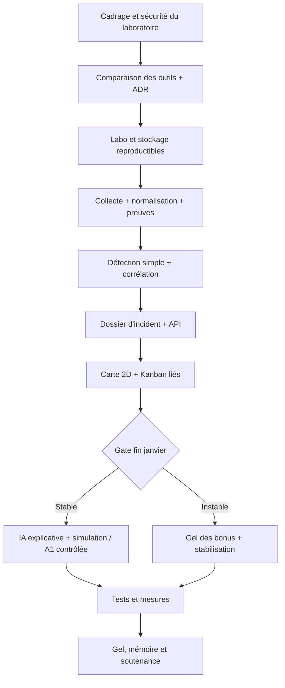

# BigBrother — Plan de réalisation du PFE (équipe de 4)

**Projet :** BigBrother — Visual SOC & Incident Workspace  
**Période de référence :** **lundi 26 octobre 2026 → dimanche 28 mars 2027 (22 semaines)**  
**Cadre :** Bachelor 3, ECE Bordeaux, PFE 2026–2027, prototype dans un laboratoire isolé.  
**Documents liés :** [README](./README.md) · [Règles de contribution](./CONTRIBUTING.md).

> **Attention au calendrier :** le cahier des charges présente une trajectoire **septembre 2026 → fin mars 2027** et un prototype de conception ; il ne prouve pas que les tâches de septembre–octobre sont terminées. Ce plan opérationnel démarre le **26/10/2026**, sans présumer de l'avancement. Les **dates officielles de rendu et de soutenance**, les vacances et la disponibilité des quatre personnes doivent être validées avec l'établissement. Les semaines 9–10 sont volontairement allégées.

## 1. Qui ? Répartition des responsabilités

Les quatre étudiants sont désignés provisoirement **E1, E2, E3 et E4** afin de ne pas inventer leurs identités. Les rôles peuvent être réattribués lors de la première réunion selon les compétences et les disponibilités.

| Référent | Domaine principal | Responsabilités | Binôme de revue |
|---|---|---|---|
| **E1 — Infrastructure & collecte** | Réseau / sécurité / laboratoire | VM, isolation réseau, capteurs, journaux hôtes, reproductibilité et expérimentation A1 | E4 (usage & intégration) |
| **E2 — Backend & données** | Architecture / API / traçabilité | Stockage, normalisation, API, RBAC, audit, orchestrateur de politiques et contrats de données | E3 (détection & IA) |
| **E3 — Détection & IA** | Data / statistiques / IA | Jeux de test, règles et ML, évaluation scientifique, corrélation, explications sourcées et limites de l'IA | E2 (services & données) |
| **E4 — Frontend & UX SOC** | Application web / visualisation | Maquettes fonctionnelles, carte 2D, Kanban, dossiers, synchronisation, accessibilité et tests utilisateurs | E1 (réalité des données) |

**La sécurité et l'intégration sont collectives.** Aucun membre n'est « seul responsable » du bon fonctionnement global : toutes les semaines, au moins une PR est relue hors du domaine de son auteur. Un étudiant peut contribuer à une autre colonne après accord sur les priorités.

**Responsabilités transversales tournantes :** animation du lundi (E1→E2→E3→E4 chaque semaine), compte rendu du vendredi (personne suivante), suivi des risques par E2 et E1 ensemble, cohérence des preuves scientifiques par E3 avec revue de toute l'équipe. Les livrables rédactionnels sont coécrits et relus.

## 2. Comment ? Méthode de travail

### 2.1 Méthode hybride : sprints d'une semaine + étapes de validation

- **Lundi :** planifier les Issues, préciser tests, dépendances et risques ; affecter un propriétaire et un relecteur. Objectif : une semaine avec des résultats vérifiables, pas seulement des activités.
- **Mardi–jeudi :** recherche/prototypes/implémentation, commits fréquents, PR courtes, tests continus et mise à jour du tableau GitHub Projects.
- **Vendredi :** démonstration intégrée même partielle, comparaison des objectifs/résultats, validation des choix techniques et ajustement du prochain sprint.
- **Chaque semaine :** un mini-rapport indiquant **ce qui était prévu, ce qui a été réalisé, les tests exécutés, les outils comparés, les décisions ADR, les risques et les actions suivantes**.

**Capacité indicative à confirmer :** 8 h par personne et par semaine pendant les semaines ordinaires (**32 h équipe**) ; 4 h par personne pendant les semaines allégées (**16 h équipe**) ; ce sont des hypothèses de planification, non des disponibilités connues. Réserver environ **20 %** à l'intégration, la documentation et les tests. Toute surcharge se traite par retrait d'extensions, pas par abandon des contrôles de sécurité.

### 2.2 Porte de décision technologique (« test avant adoption »)

Pour **chaque composant structurant** :

```text
Besoin → panorama des alternatives → présélection motivée
       → tests comparables de TOUTES les options présélectionnées
       → mesures et tableau de scores → ADR documentée et relue
       → décision Go / No-Go → intégration sur develop
       → vérification d'un remplacement possible
```

**Sans benchmark reproductible et justification écrite, pas d'adoption.** Un prototype sur `spike/` est autorisé **pour comparer**, sans rendre le choix irréversible. Les candidats présélectionnés doivent tous être expérimentés ; une option seulement identifiée mais non testée doit être exclue avec motif objectif et vérifiable. Éviter de faire semblant de tester tous les produits du marché ; documenter le périmètre de recherche.

Critères par défaut (score **0 à 5**) : **sécurité 25 %**, **adéquation/intégration 20 %**, **performance/ressources 20 %**, **maintenabilité 15 %**, **portabilité/local 10 %**, **licence/coût 10 %**. Les exigences éliminatoires (sécurité, absence de fuite de données, compatibilité laboratoire) priment sur la moyenne. Les pondérations et tests doivent être déterminés **avant** les résultats.

### 2.3 Définition des livrables hebdomadaires

Chaque semaine clôturée doit produire au minimum : **1 élément vérifiable** (prototype, test, API, écran, benchmark ou ADR), **1 trace documentaire**, **1 revue croisée** et **1 mise à jour du tableau de bord du projet**. Les deux semaines allégées privilégient recherche/documentation et revue asynchrone.

## 3. Quoi comparer, comment et quand ? Plan expérimental

Les comparaisons ci-dessous sont des **candidatures**, pas des choix déjà actés. Les dates couvrent la présélection, les expérimentations et l'ADR ; les tests doivent précéder l'usage définitif dans l'application.

| Décision technique | Alternatives à présélectionner et tester | Tests comparables / critères de décision | Responsable / période | Preuve attendue |
|---|---|---|---|---|
| Virtualisation | VirtualBox, Proxmox ; autre selon matériel | Temps d'installation, RAM/CPU, clonage, isolation, snapshots, compatibilité | E1 / S03–S04 | ADR-LAB + configurations de test |
| Capteurs réseau | Zeek seul, Suricata seul, combinaison | Types d'événements utiles, bruit, CPU, détection sur captures identiques | E1 / S04–S05 | ADR-SENSORS ; préciser complémentarité possible |
| Données hôtes | Sysmon + journaux Windows, mécanismes Linux (journald, auditd si utile) | Couverture, qualité, volume, horodatage, privilèges | E1 / S05–S06 | ADR-HOST-LOGS |
| Transport / normalisation | Vector, Fluent Bit, Logstash | JSON valide/invalide, provenance, débit, pertes, RAM | E2 / S05–S06 | ADR-PIPELINE |
| Stockage | PostgreSQL, SQLite, autre candidat motivé | Recherche d'incident, données horodatées, concurrence, migrations, coût | E2 / S03–S04 | ADR-STORAGE |
| Backend | FastAPI, Django REST, NestJS | Même CRUD et contrôle RBAC, validation, tests, documentation OpenAPI, temps d'implémentation | E2 / S04–S05 | ADR-BACKEND |
| Frontend | React/TypeScript, Vue/TypeScript, Svelte/TypeScript | Maquette identique, accessibilité, écosystème, complexité, maintenance | E4 / S03–S04 | ADR-FRONTEND |
| Visualisation réseau | Cytoscape.js, React Flow, D3.js | Même graphe et nombre de nœuds, interactions, FPS/latence, provenance et lisibilité | E4 / S04–S05 | ADR-GRAPH |
| Kanban / gestion interactions | UI native, bibliothèque de drag-and-drop présélectionnée, autre solution | Clavier, permissions, ergonomie, transitions sans action réseau | E4 / S05–S06 | ADR-KANBAN-UI |
| Détection | Seuils/règles ; z-score/robust stats ; Isolation Forest ; autre modèle pertinent | Même partition train/test, précision, rappel, F1, faux positifs/h, latence et CPU | E3 / S05–S13 | ADR-DETECTION + rapport métriques |
| IA locale | Ollama/modèles adaptés, llama.cpp/modèle compatible, **sans LLM** | Hors ligne, preuve citée, hallucinations, injection de consignes, latence, RAM | E3 / S04, S13–S14 | ADR-LOCAL-AI + cas négatifs |
| Actualisation | SSE, WebSocket, polling contrôlé | Même flux incidents, synchronisation, reprise connexion, charge | E2+E4 / S13–S14 | ADR-REALTIME |
| Réponse de laboratoire | Simulation pure, OPNsense, autre mécanisme de labo approprié (ex. pfSense/nftables selon ressources) | Prévisualisation, règle bornée, permission, TTL, audit, annulation, isolation | E1+E2 / S15–S16 | ADR-RESPONSE ; autorisation préalable |
| Packaging / exécution | Docker Compose, scripts reproductibles, autre outil retenu au besoin | Reconstruction sur machine neuve, secrets, complexité, portabilité | E1+E2 / S03 et S18 | ADR-DEPLOYMENT |
| Traitement asynchrone (si nécessaire) | Processus simple, tâches intégrées, Celery/Redis, RQ/Arq | Même charge, retries, reprise après panne, coût opérationnel | E2 / seulement si besoin mesuré | ADR-ASYNC ou décision « aucun outil » |

**Important :** ces outils ne sont pas tous interchangeables. Les comparaisons mettent en évidence **ce qu'un composant apporte**, pas seulement lequel « gagne ». Par exemple, Zeek et Suricata peuvent être complémentaires, et un composant différé inutile doit être **écarté** plutôt qu'ajouté par habitude.

**Preuves conservées :** branche `spike/`, protocole, versions, machine, charge fixe, jeu de données **synthétique**, captures anonymisées, mesures CSV/Markdown, limites, tableau de scores, ADR approuvée. Aucune adoption fondée sur le seul fait qu'un outil est connu ou utilisé par un membre.

## 4. Quand ? Planning détaillé semaine par semaine

**Lecture :** E1/E2/E3/E4 désignent les référents ; chaque ligne contient les tâches concrètes et la preuve de fin de semaine. Les périodes s'alignent sur la fin mars du cahier des charges mais **devront être recalées** après confirmation des contraintes officielles.

| Semaine et dates | E1 — Infrastructure / collecte | E2 — Backend / données | E3 — Détection / IA | E4 — Frontend / UX | Livrable commun / jalon |
|---|---|---|---|---|---|
| **S01 · 26/10–01/11** | Inventaire matériel et réseau autorisé ; cartographier les risques du labo | Décomposer M01–M20 en Issues ; définir les premiers contrats de données | Définir question scientifique, scénarios, métriques et exigences IA | Analyser maquettes, parcours novice et critères UX01–UX04 | **Kickoff :** rôles validés, backlog priorisé, conventions Git, risques, exigences de sécurité, date PFE à confirmer |
| **S02 · 02/11–08/11** | Recenser les alternatives de VM, capteurs, déploiement | Recenser backend, stockage, pipeline et critères techniques | Recenser modèles/règles et options IA locale ; créer le protocole | Recenser frameworks, graphes et Kanban ; figer les cas d'usage | **Panorama + protocoles** : présélections motivées, matrice de test, premier schéma d'architecture et plan d'étude de l'existant |
| **S03 · 09/11–15/11** | Bench **VirtualBox vs Proxmox** sur machines comparables ; isoler le labo | Bench **PostgreSQL vs SQLite** (ou autres présélectionnées), prototyper schéma | Préparer générateurs de données normales/anormales et baseline statistique | Bench **React vs Vue vs Svelte** sur même mini-dashboard | **Gate T1 :** ADR virtualisation, stockage et frontend ; aucun de ces composants n'est intégré définitivement avant décision |
| **S04 · 16/11–22/11** | Comparer **Zeek / Suricata / combinés**, mêmes traces contrôlées | Comparer **FastAPI / Django REST / NestJS**, même API simple | Comparer exécution locale **Ollama / llama.cpp / sans LLM** sur tests simples | Comparer **Cytoscape.js / React Flow / D3**, même topologie | **Gate T2 :** rapports comparatifs capteurs/backend/graphe ; premières ADR ; vérifier contraintes matériel et confidentialité IA |
| **S05 · 23/11–29/11** | Évaluer journaux Windows/Linux (Sysmon, journald, auditd si adapté) | Comparer **Vector / Fluent Bit / Logstash** sur mêmes flux | Mesurer règles simples/z-score et préparer partition train/test de détection | Tester Kanban natif vs bibliothèque DnD présélectionnée ; clavier / accessibilité | **Gate T3 :** ADR sources hôtes, pipeline, composants Kanban ; jeu de données/version et métriques de référence documentés |
| **S06 · 30/11–06/12** | Installer le **labo retenu** après ADR ; scripts et sauvegarde des configurations sans secrets | Construire DB/API et collecteur **retenus** après ADR ; schéma initial | Établir baseline détecteur et scripts reproductibles ; données annotées | Créer shell de l'application avec stack **validée** ; composants fictifs temporaires | **Jalon architecture :** environnement réinstallable et démo minimale factice ; contrats API et documentation démarrage |
| **S07 · 07/12–13/12** | Connecter une source réseau de labo, tracer origine et horodatages | Implémenter réception, validation, normalisation et erreurs quarantainées | Produire indicateurs sur fenêtres 1/5/15 min et tests événements tardifs | Implémenter vue des actifs/topologie avec données simulées cohérentes | **M01–M03 partiels :** premier événement brut et normalisé retrouvable, carte d'actifs testable |
| **S08 · 14/12–20/12** | Ajouter une source hôte, simuler perte de sonde | Relier actifs, relations et événements en base ; premières routes GET | Détection initiale par règles, scoring et références de preuves | Relier la carte à l'API ; fiche d'actif + états « inconnu » | **Jalon V1 :** collecte réelle contrôlée → stockage → carte ; 1 test bout-en-bout positif et 1 négatif |
| **S09 · 21/12–27/12** *(allégée)* | Documenter schémas du labo et restaurations | Nettoyer API et documents de conception | Analyser faux positifs sur données existantes | Vérifier maquettes, textes simples et navigation clavier | **Revue documentaire asynchrone :** zéro nouvelle dépendance majeure ; journal de risques et backlog janvier |
| **S10 · 28/12–03/01** *(allégée)* | Vérifier sauvegardes/configuration sans secrets | Relecture et contrôle de cohérence des ADR/contrats | Préparer jeu de validation gelé de janvier | Préparer tests d'intégration carte/Kanban | **Préparation sprint janvier :** critères d'acceptation et jeux de tests figés ; pas de livraison risquée |
| **S11 · 04/01–10/01** | Stabiliser les sondes, valider pertes et événements ambigus | Implémenter corrélation initiale et API de création d'incident | Comparer règles/statistiques/**Isolation Forest** sur jeux séparés | Développer tableau Kanban relié à l'API + filtres de base | **M04/M06/M17 :** une alerte du labo crée un dossier traçable et une carte Kanban ; rapport comparatif détection provisoire |
| **S12 · 11/01–17/01** | Tester incidents simulés et délais de remontée capteur | Implémenter preuves, chronologie, états et persistance | Ajuster seuils en évitant les fuites train/test ; rapport F1/FP | Lier clic actif↔incident et afficher une fiche unique | **Gate parcours sans IA :** scénario alerte→dossier→carte↔Kanban ; tests UX01/UX03 et preuves reliées |
| **S13 · 18/01–24/01** | Tester données manquantes, sonde débranchée et provenance | Ajouter RBAC serveur, audit, accès aux preuves | Comparer les options IA locale sur qualité des citations, latence et injection de consignes | Développer fiche détaillée, chronologie, recherche et affichage des incertitudes | **M07/M10/M18 :** l'IA reste facultative ; droits lecteur refusés ; ADR IA actualisée |
| **S14 · 25/01–31/01** | Exécuter la démonstration lab de bout en bout ; identifier les écarts | Bench **SSE / WebSocket / polling**, intégration après ADR | Ajouter résumé fondé sur preuves + mode dégradé sans LLM | Synchronisation carte/Kanban, filtres et états en quasi temps réel | **Gate J (Go/No-Go) :** **collecte → détection → dossier → carte et Kanban** stable. Sinon, geler cloud/3D/bonus et corriger |
| **S15 · 01/02–07/02** | Comparer simulation seule / options de pare-feu **dans le labo autorisé** | Définir politiques A0–A3 et API de prévisualisation sans exécution | Tester requêtes adversariales sur agent et journal malveillant simulé | Écran prévisualisation, consentement et avertissements | **Gate T4 :** ADR réponse, politique A0–A3, preuve qu'aucune mesure non autorisée ne s'exécute |
| **S16 · 08/02–14/02** | Tester **A1 temporaire** sur adresse de test, durée, arrêt, rollback | Implémenter approbation, exécution contrôlée, audit et annulation après validation | Vérifier recommandations IA séparées des actions ; agent sans shell arbitraire | Relier UI de simulation à la décision humaine et au journal | **Jalon réponse :** parcours simulation→validation→A1→vérification→rollback ; A2 non autonome, A3 refusé |
| **S17 · 15/02–21/02** | Tester déconnexions et restauration d'une sonde | Tests de rôles, répétitions d'API, erreurs et cohérence audit | Évaluer précision/rappel/F1, faux positifs, refus d'injections | Premier test utilisateur encadré ; corriger ambiguïtés et clavier | **Jalon sûreté :** rapport sécurité + protocole UX, principaux risques traités ou explicités |
| **S18 · 22/02–28/02** | Comparer installation Docker Compose/scripts (si pas déjà décidé), reconstruire sur environnement neuf | Export et anonymisation, vérification portabilité et migrations | Rapport scientifique préliminaire avec limites et scénarios non détectés | Accessibilité, aide utilisateur, vue prévention optionnelle uniquement si temps | **Gate F :** gel des fonctionnalités ; L03–L09 au moins en version candidate ; priorité absolue aux défauts critiques |
| **S19 · 01/03–07/03** | Mesurer débit 100 événements/s 30 min, stabilité labo | Mesurer latence, audit et comportement des API | Consolider comparatifs ML/IA et reproductibilité | Mesurer page sous 3 s et tests UX01–UX04 | **Campagne de tests formalisée :** mesures réelles NF01–NF10/UX01–UX04, échecs et écarts consignés |
| **S20 · 08/03–14/03** | Stabiliser installation et lancement « machine neuve » | Corriger anomalies bloquantes, tester 99 % disponibilité sur 7 jours glissants | Rédiger méthodes/résultats/limites du mémoire | Finaliser guide utilisateur, captures anonymisées et démo | **Release candidate :** tests de non-régression, procédure de restauration, brouillon mémoire, application gelée |
| **S21 · 15/03–21/03** | Préparer environnement de soutenance + secours | Préparer schémas d'API, architecture, sécurité, droits | Finaliser résultats comparatifs et réponses aux questions scientifiques | Préparer support oral, répétition complète et vidéo de secours | **Répétition 20 min** : démonstration chronométrée, rapport/mémoire presque finaux et dossier de preuves |
| **S22 · 22/03–28/03** | Vérification laboratoire, sauvegarde, matériel | Vérification version stable, tags, documentation | Vérification chiffres, scripts reproductibles et limites | Derniers ajustements visuels non risqués et présentation | **Livraison PFE / soutenance selon date confirmée :** code stable, L01–L10, mémoire, slides, vidéo secours, bilan collectif |

### Répartition indicative des charges et priorités

| Période | Nature du travail | Priorité |
|---|---|---|
| S01–S05 | Cadrage, alternatives, tests comparatifs, ADR | Aucun outil majeur adopté sans preuve |
| S06–S08 | Socle et première verticale technique | Données réelles **autorisées** + provenance |
| S09–S10 | Documentation, consolidation, temps réduit | Éviter les nouveaux composants |
| S11–S14 | Détection, dossiers, carte, Kanban, IA explicative | Parcours complet **avant fin janvier** |
| S15–S18 | Gardes-fous, A1 réversible, tests, gel | Sécurité, robustesse, résultats reproductibles |
| S19–S22 | Mesures, corrections, mémoire, démonstration | Aucune nouvelle fonctionnalité risquée |

## 5. Conditions de passage et jalons de décision

| Gate | Date indicative | Critères d'entrée / de réussite | En cas d'échec |
|---|---|---|---|
| **G0 — Projet cadré** | Fin S02 (08/11) | Rôles, backlog, sécurité du labo, liste outils/alternatives, protocoles, risques | Bloquer l'implémentation définitive ; faire valider les manques |
| **G1 — Stack justifiée** | Fin S05 (29/11) | Benchmarks et ADR approuvées pour le socle ; licences compatibles | Prolonger `spike/`, réduire le nombre de fonctions, ne pas « choisir au hasard » |
| **G2 — Flux initial** | Fin S08 (20/12) | Événement collecté, normalisé, conservé, relié à un actif et visible dans l'API/interface | Prioriser pipeline/provenance avant ML avancé |
| **G3 — Parcours sans action risquée** | Fin S14 (31/01) | Collecte→détection→dossier→carte/Kanban, preuve liée, droits de lecture, démo reproductible | **Réduire le périmètre** : aucune 3D, cloud, prévention avancée ni bonus IA |
| **G4 — Réponse sous contrôle** | Fin S17 (21/02) | Simulation, droits, validation, refus A3, audit ; A1 réel seulement si autorisé et rollback démontré | Conserver uniquement la **simulation** sûre et déclarer A1 non réalisé |
| **G5 — Recette et gel** | Fin S18 (28/02) | Tests critiques, documentation et critères de preuve suffisants pour le mémoire | Corriger en priorité les défauts de sûreté et d'intégration |
| **G6 — Livraison PFE** | S22 (avant date officielle) | Version taguée, installation démontrée, tests mesurés, mémoire et scénario de secours | Démonstration enregistrée et limites assumées ; pas de résultat inventé |

**Règle d'arbitrage :** lorsqu'un jalon est menacé, conserver d'abord (1) laboratoire isolé, (2) provenance, (3) détection simple, (4) dossier, (5) carte+Kanban, (6) RBAC/audit/simulation ; réduire en premier cloud, 3D, collaboration avancée, connecteurs supplémentaires et modèles sophistiqués.

## 6. Dépendances et chemin critique



**Dépendances à anticiper :**

- La carte n'est crédible que si l'inventaire et l'origine des liens sont disponibles. Une relation inconnue reste **inconnue**, jamais inventée.
- Le Kanban ne remplace pas la piste d'audit : changer une carte n'exécute pas une règle réseau.
- Les comparaisons de modèles exigent un jeu de test séparé **avant** l'ajustement des seuils.
- L'IA explique les preuves disponibles, **sans décider seule** d'une action risquée ; une panne du modèle ne casse pas le parcours.
- Les réponses contrôlées dépendent d'abord des politiques A0–A3, de la validation humaine, du test de rollback et de l'isolation.
- Le mémoire scientifique dépend des journaux de benchmarks et d'essais accumulés toute l'année, pas d'une rédaction de dernière minute.

## 7. Critères de réussite du MVP (traçabilité PFE)

| Axe | Modules du cahier des charges | Preuve attendue |
|---|---|---|
| Collecte et données | M01, M02, M03, M15 | Deux sources contrôlées si réalisable, normalisation, provenance, export JSON, test de reprise |
| Détection et contexte | M04, M05, M06, M08 | Règles et méthode ML comparées, score reproductible, corrélation, faux positif qualifiable |
| Explications IA | M07, M12 | Faits vs hypothèses, liens vers preuves, échec IA non bloquant, refus d'injections |
| Interface Visual SOC | M09, M16, M18, M20 | Carte 2D avec provenance, fiche d'actif, états réels, actualisation cohérente |
| Gestion des incidents | M17, M18, M19 | Kanban et dossier unifié, droits, historique ; collaboration avancée facultative |
| Actions et administration | M10, M11 | RBAC côté serveur, audit, simulation, validation, A3 refusé, rollback A1 si autorisé |
| Prévention et reporting | M13, M14 | Bonus uniquement si le flux MVP est stable ; résultats anonymisés |

**Objectifs de qualité du cahier des charges (à mesurer, jamais présumés) :** NF01 100 événements/s sur 30 min ; NF02 95 % des fenêtres sous 30 s ; NF03 page principale sous 3 s ; NF04 99 % de disponibilité sur 7 jours ; NF05 preuves sur tous les dossiers de test ; NF06 action liée à un acteur/politique ; NF07 aucune exécution hors autorisation ; NF08 rollback A1 ; NF09 aucun journal brut sortant en mode local ; NF10 reconstruction sur environnement neuf. UX01 carte↔Kanban, UX02 synchronisation, UX03 statut sans action réseau, UX04 parcours novice ciblé en 5 min.

**Aucune valeur atteinte ne doit être déclarée sans mesure.** En cas de cible non atteinte, publier la valeur observée, les conditions et l'explication de l'écart.

## 8. Registre de risques et réponse préventive

| Risque | Déclencheur à surveiller | Réponse proposée | Responsable de suivi |
|---|---|---|---|
| Trop d'outils à comparer | ADR en retard / benchmarks incomplets S05 | Réduire la présélection aux alternatives pertinentes, documenter toutes les exclusions, conserver les tests identiques | E2 + les 4 |
| Matériel insuffisant | VM lentes, OOM, services indisponibles | Diminuer le nombre de VM, tests fractionnés, IA plus compacte ou sans LLM | E1 |
| Chaîne technique cassée | Aucun incident complet à S12–S14 | Stopper fonctions secondaires et construire un scénario vertical minimal | E2 + E3 |
| Carte trompeuse | Liens inventés, état « sain » malgré sonde muette | Afficher source, date, fiabilité, « inconnu » | E1 + E4 |
| Faux positifs et IA imprécise | Score F1 faible / résumés non sourcés | Comparer aux règles, séparer faits et hypothèses, retenir le mode sans IA | E3 |
| Action non autorisée | Échec de test RBAC, absence de rollback | Désactiver toute exécution réelle, conserver la simulation, audit et correction | E1 + E2 |
| Données d'essai insuffisantes | Aucun jeu gelé à S10 | Générer scénarios normal/suspect de labo, documenter limites de représentativité | E3 |
| Retards académiques | Dépassement jalon G3 ou rendu avancé | Replanification hebdomadaire, gel des bonus, démo de secours | Équipe complète |
| Fuite de données | Présence d'un secret/log brut en PR | Révoquer, nettoyer, prévenir, bloquer publication ; contrôles CI | E2 + E1 |
| Reproductibilité absente | Démarrage possible sur un seul poste | Scripts, versions fixées, reconstruction sur environnement neuf S18–S20 | E1 + E2 |

## 9. Livrables officiels et responsables de préparation

La numérotation **L01 à L10** reprend les livrables du cahier des charges (le détail opérationnel ci-dessous précise les responsabilités).

| Livrable | Contenu | Référent de coordination | Échéance interne |
|---|---|---|---|
| **L01** | Cahier des charges, maquettes et validation | E4 + tous | S02 puis mises à jour validées |
| **L02** | Étude de l'existant, panorama d'outils, benchmarks, ADR et justifications | E3 + tous | S05, enrichi jusqu'à S19 |
| **L03** | Laboratoire reproductible, scripts, configurations sans secrets | E1 | S08, validé S20 |
| **L04** | Application (frontend, API) et documentation de lancement | E2 + E4 | S14, stabilisé S20 |
| **L05** | Carte 2D et Kanban liés à de vraies données de labo | E4 | S14 |
| **L06** | Collecte, détection, corrélation, preuves et assistant IA encadré | E1 + E3 | S14–S17 |
| **L07** | Politique A0–A3, simulations, audit et rollback éventuel A1 | E1 + E2 | S17 |
| **L08** | Jeux de test, protocoles, comparaison des méthodes et résultats mesurés | E3 | S19 |
| **L09** | Guides utilisateur/sécurité et règles de protection des données | E2 + E4 | S18–S20 |
| **L10** | Mémoire, présentation, démo chronométrée, vidéo de secours | Tous, coordination tournante | S21–S22 |

## 10. Format du compte rendu hebdomadaire

À créer pour chaque semaine sous `docs/weekly/SXX-AAAA-MM-JJ.md` ou dans une Issue « Weekly review », afin de pouvoir reconstruire l'historique des décisions.

```markdown
# SXX — du JJ/MM au JJ/MM
## Objectifs annoncés
- E1 :
- E2 :
- E3 :
- E4 :
## Réalisé / non réalisé
- Issue / PR / résultat vérifiable :
## Outils testés cette semaine
- Besoin ; candidats ; protocole identique ; résultat ; lien ADR
## Tests et preuves
- Mesures, tests négatifs, captures anonymisées, incidents constatés
## Risques / blocages
- Risque ; responsable ; date d'arbitrage ; action
## Décisions Go / No-Go
- Décision ; justification ; approbations
## Prochaine semaine
- Priorités et dépendances ; actions de rattrapage si nécessaire
```

## 11. Prochaines actions concrètes (dès S01)

1. **Faire valider** par les quatre étudiants et l'encadrant : calendrier officiel, périmètre, ressources de laboratoire, contraintes légales et données d'essai autorisées.
2. **Créer** la branche `develop`, protéger `main` et `develop`, installer les templates GitHub Projects/Issues/PR et la CI de base ; voter les règles de projet.
3. **Découper** les modules M01–M20 en Issues reliées aux semaines et aux livrables L01–L10 ; nommer responsables et relecteurs.
4. **Lancer les comparaisons en parallèle** : E1 virtualisation/capteurs, E2 stockage/API/collecte, E3 méthodes statistiques/IA, E4 UI/graphe ; ne pas adopter définitivement avant ADR.
5. **Réserver les dates de démonstration** : flux initial fin décembre, chaîne verticale fin janvier, réponse encadrée fin février et répétition mi-mars.

---

**Source de périmètre :** *BigBrother — Cahier des charges fonctionnel, technique et expérimental*, sections 1–11, ECE Bordeaux, année 2026–2027. **Ajouts de gestion proposés :** sprints hebdomadaires, rôles E1–E4, dates du 26/10/2026 au 28/03/2027, benchmarks systématiques, ADR, règles de collaboration et gates ; ils doivent être validés collectivement.
