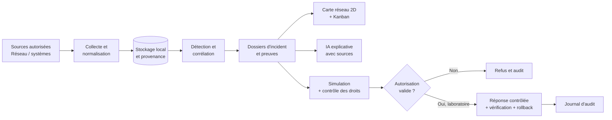

# BigBrother — Visual SOC & Incident Workspace

> **Voir le réseau. Comprendre les incidents. Agir sous contrôle.**
>
> Projet de fin d'études (PFE) — Bachelor 3 Développeur en Intelligence Artificielle, ECE Bordeaux, promotion **2026–2027**.

**Statut :** phase de cadrage et de conception · **Équipe :** 4 étudiants · **Cadre :** prototype académique dans un laboratoire isolé.

> [!IMPORTANT]
> Ce dépôt présente un **projet en développement**. Les maquettes, les performances et les fonctionnalités décrites sont des **objectifs**, et non des éléments déjà implémentés ou validés. BigBrother n'est ni un antivirus/EDR complet, ni une solution de protection prête pour la production, ni un outil de surveillance de personnes.

## 1. Présentation

**BigBrother** est une plateforme web expérimentale de supervision de cybersécurité (*Security Operations Center*, SOC). Elle vise à réunir, dans un espace de travail cohérent :

- une **carte interactive 2D** des actifs et de leurs relations réseau, avec origine et fraîcheur des informations ;
- un **tableau Kanban** pour organiser le cycle de vie des incidents ;
- un système de **collecte, normalisation, détection et corrélation** des événements ;
- des **fiches d'incident** liant chronologie, preuves, hypothèses et décisions ;
- un **assistant IA explicatif** soumis à des règles de traçabilité et de contrôle humain ;
- un mécanisme de **simulation et d'approbation des réponses** avec audit et retour arrière lorsque permis.

### Problématique

Les informations utiles à un analyste SOC sont généralement dispersées entre journaux système, capteurs réseau, outils de détection et tableaux de suivi. BigBrother cherche à réduire le temps nécessaire pour **identifier les actifs concernés, relier les preuves à un incident et décider de la suite**, sans augmenter les erreurs ni les actions injustifiées.

**Question étudiée :** une interface qui relie détection, topologie réseau, dossiers d'incident et réponses encadrées améliore-t-elle le traitement des alertes par rapport à une supervision plus passive ?

## 2. Chaîne de fonctionnement envisagée

L'interface **ne déclenche jamais une mesure technique simplement parce qu'un incident change de colonne**. Les décisions sensibles passent par un service distinct de l'interface et de l'assistant IA.

## 3. Fonctionnalités prioritaires (MVP)

| Domaine | Fonctionnalité attendue | Exemple de vérification |
|---|---|---|
| Collecte | Recevoir des journaux réseau et système dans un format commun, avec provenance | Retrouver un événement et son original |
| Détection | Comparer des règles simples à au moins une méthode statistique/ML | Reproduire les scores sur un jeu de test séparé |
| Incidents | Créer des dossiers avec priorité, preuves et chronologie | Une alerte produit un dossier exploitable |
| Visual SOC | Afficher la topologie 2D, les états et les relations vérifiables | Cliquer sur un actif affiche ses incidents |
| Incident Workspace | Gérer les états « Nouveau », « À analyser », « Réponse proposée », « En traitement », « Résolu » | Les transitions sont autorisées et historisées |
| Synchronisation | Relier carte, Kanban et fiche détaillée | Le même incident apparaît correctement dans toutes les vues |
| IA explicative | Séparer faits, hypothèses, incertitudes et vérifications | Les affirmations importantes renvoient aux preuves ; l'application fonctionne sans IA |
| Contrôles | Authentification, rôles, simulation, audit et vérification de politique | Une action interdite est refusée et tracée |

**Fonctionnalités conditionnelles :** réponse réelle **A1** de faible impact et réversible dans le laboratoire, attribution collaborative, prévention et statistiques anonymisées. Elles ne doivent pas compromettre le MVP.

**Hors périmètre du PFE :** exploitation en production, surveillance à l'insu des utilisateurs, attaques de systèmes tiers, mesures destructrices, cloud Azure obligatoire, 3D et multi-organisation.

## 4. Architecture technique — candidats à évaluer

Les outils ci-dessous proviennent du cahier des charges ou constituent des **alternatives à tester**. **Aucun de ces choix ne doit être considéré comme définitivement retenu avant comparaison et décision documentée.**

| Besoin | Technologies envisagées / comparées |
|---|---|
| Virtualisation du laboratoire | VirtualBox, Proxmox ; alternatives présélectionnées selon le matériel |
| Observation réseau | Zeek, Suricata ; évaluer également leur complémentarité |
| Journaux hôtes | Sysmon, journaux Windows/Linux et mécanismes natifs appropriés |
| Collecte et transformation | Vector, Fluent Bit, Logstash |
| Stockage | PostgreSQL, SQLite (référence légère), autre option si justifiée |
| API et services | FastAPI/Python, Django REST Framework, NestJS (selon compétences) |
| Analyse de données | Règles déterministes, statistiques simples, Isolation Forest et autres modèles candidats |
| IA explicative locale | Ollama, llama.cpp et scénario sans LLM |
| Frontend | React/TypeScript, Vue/TypeScript, Svelte/TypeScript |
| Carte 2D | Cytoscape.js, React Flow, D3.js |
| Actualisation | SSE, WebSocket, polling contrôlé |
| Packaging local | Docker Compose ou installation scriptée reproductible |

Pour chaque catégorie : **présélection → prototype équivalent → mesures → tableau comparatif → justification écrite (ADR) → validation de l'équipe → intégration**. Les alternatives présélectionnées sont toutes testées avec les mêmes cas d'usage ; toute exception est expliquée. Les expériences sont réalisées en environnement de test avant adoption.

## 5. Sécurité, limites et éthique

BigBrother est testé **exclusivement dans un réseau de laboratoire isolé**, sur des actifs contrôlés ou explicitement autorisés. Les règles suivantes sont structurantes :

- **Traçabilité :** chaque alerte et incident conserve la source, les dates, les références de preuves et l'historique des décisions.
- **Zéro confiance implicite dans l'IA :** un résumé généré n'est pas une preuve ; aucune commande terminal arbitraire n'est accessible à l'agent.
- **Rôles et autorisations côté serveur :** analyste, administrateur, lecteur/auditeur ; journalisation des opérations sensibles.
- **Réponses bornées :** A0 = observation ; A1 = faible impact et réversible sous politique explicite ; A2 = validation humaine obligatoire ; A3 = interdit.
- **Exécution prudente :** prévisualisation, vérification des droits, politique, validation si requise, contrôle du résultat, retour arrière et arrêt d'urgence.
- **Confidentialité :** données minimisées, mode local strict par défaut ; aucun secret, journal brut ou élément sensible publié dans le dépôt ou les rapports.

Les journaux externes sont considérés comme **des données non fiables** et ne doivent jamais devenir des instructions pour l'assistant.

## 6. Démonstration visée

Scénario illustratif du cahier des charges, **non encore implémenté** :

1. Une sonde du laboratoire observe des connexions SSH répétées sur `DB-01`.
2. Une détection relie les signaux à des preuves horodatées.
3. `DB-01` est mis en évidence sur la carte et un incident apparaît dans le Kanban.
4. L'analyste ouvre une fiche commune présentant faits, preuves et incertitudes.
5. Une réponse temporaire est d'abord **simulée** ; elle n'est exécutée que si la politique et les habilitations l'autorisent.
6. L'équipe vérifie son effet, teste l'annulation et consulte la piste d'audit.

## 7. Évaluation du prototype

Le rapport distinguera systématiquement les **objectifs** des **mesures effectivement obtenues**.

| Indicateur / test | Cible de recherche, à vérifier |
|---|---|
| Débit d'ingestion | 100 événements/s pendant 30 min |
| Latence de traitement | 95 % des fenêtres en moins de 30 s |
| Chargement de la page principale | Moins de 3 s sur jeu de test fixé |
| Disponibilité | 99 % sur une semaine d'essai |
| Preuves et audit | Tous les dossiers de test ont des preuves ; chaque action testée a un acteur et une politique |
| Contrôle de réponse | Aucune exécution interdite ; retour arrière A1 réussi |
| Mode local strict | Aucun journal brut envoyé à l'extérieur |
| Ergonomie | Carte et Kanban cohérents ; parcours de consultation novice ciblé en 5 min |

Mesures supplémentaires : précision, rappel, score F1, fausses alertes par heure, temps de qualification, consommation CPU/RAM et résultats de tests négatifs (autorisations, données tardives, indisponibilité de l'IA, faux positifs).

## 8. Organisation et documentation

Le travail est organisé en **équipe de quatre**, avec un responsable principal par chantier, des revues croisées et un tableau GitHub Projects/Issues.

- **[Règles du projet](./CONTRIBUTING.md)** — conventions Git, branches, commits, Pull Requests, sécurité, qualité et décisions techniques.
- **[Plan du projet](./PLAN_PROJET.md)** — qui fait quoi, calendrier hebdomadaire, jalons, comparatifs technologiques et critères de validation.
- **Cahier des charges BigBrother** — document source du PFE, à conserver séparément selon les règles de diffusion de l'équipe.

### État d'avancement

| Étape | Statut initial |
|---|---|
| Cadrage et spécification | Cahier des charges proposé, validation pédagogique à confirmer |
| Étude comparative et choix techniques | À réaliser |
| Laboratoire reproductible | À réaliser |
| Collecte, détection, API | À réaliser |
| Carte interactive et Kanban | À réaliser |
| IA explicative, réponse contrôlée et audit | À réaliser |
| Tests comparatifs, mémoire et soutenance | À réaliser |

## 9. Installation et contribution

**L'installation n'est pas encore disponible** : le dépôt ne contient pas à ce stade d'application exécutable ou de procédure de démarrage validée. Les commandes et prérequis seront ajoutés après les premières comparaisons techniques et la mise en place d'un environnement reproductible.

Pour contribuer au projet :

1. Lire les [règles du projet](./CONTRIBUTING.md) et le [planning](./PLAN_PROJET.md).
2. Prendre une **Issue** affectée, avec critères d'acceptation précis.
3. Créer une branche de travail depuis `develop` suivant la convention définie.
4. Ajouter les tests et la documentation utiles ; proposer une **Pull Request**.
5. Obtenir une revue croisée et laisser passer les contrôles CI avant fusion.

Pour signaler une vulnérabilité, éviter de publier des détails exploitables et privilégier un signalement privé au responsable du dépôt.

## 10. Équipe et attribution

Quatre rôles de coordination sont proposés : **infrastructure & collecte**, **backend & données**, **détection & IA**, **frontend & expérience SOC**. Chaque décision d'architecture structurante est prise collectivement, et chaque module doit être repris en revue par une deuxième personne.

Les noms et contacts seront renseignés avec l'accord des membres du groupe.

## 11. Licence

**Aucune licence n'a été identifiée dans le dépôt lors de la préparation de ce README.** Le fait qu'un dépôt soit public ne confère pas automatiquement une licence de réutilisation. L'équipe devra clarifier les droits des quatre contributeurs et choisir, avec l'encadrant si nécessaire, une politique de diffusion avant toute publication de code substantiel.

---

**Références :** cahier des charges fonctionnel, technique et expérimental *BigBrother — Visual SOC & Incident Workspace*, ECE Bordeaux, PFE 2026–2027 ; dépôt [Hammulabi/BigBrother](https://github.com/Hammulabi/BigBrother).
